# 원하는 포즈로 이미지 만드는 도구

[](https://colab.research.google.com/github/docie-rgb/pose-image-tool/blob/main/pose_tool.ipynb)

## 도구 설명
- 관절 좌표(OpenPose 18점)와 소품(벤치·베개·강철 받침대) 배치를 **사람이 직접 지정**해 포즈 조건 이미지를 만들고, FLUX.2-klein 4B로 같은 자세의 사진을 생성합니다.
- 생성된 사진에서 OpenPose 뼈대를 다시 뽑아 목표 뼈대와 비교(PCK, BASE-01 자세 규칙)해 "정말 같은 자세인지"를 숫자로 남깁니다. 숫자와 별도로 모든 결과를 눈으로 다시 확인해 아래에 함께 적었습니다.
- **사용법 한 줄**: `pose_tool.ipynb`를 Colab GPU 런타임에서 열고 3-5 셀에서 포즈를 승인한 뒤 [런타임] → [모두 실행].

| 경로 | 방식 | 정식 ControlNet? |
|---|---|---|
| **A** | 포즈 스케치(A-sketch) 또는 OpenPose 뼈대(A-openpose)를 Klein 4B의 **참조 이미지(`image=`)** 로 넣고 프롬프트로 자세를 지시 | **아니오** — Klein 4B에는 공식 OpenPose ControlNet이 없습니다 |
| **B** | SDXL + `xinsir/controlnet-openpose-sdxl-1.0`으로 초안(B-draft) → Klein 4B로 다듬기(B) | SDXL 단계만 정식 ControlNet |

## 사용법
1. 위 Colab 배지로 노트를 엽니다. [런타임] → [런타임 유형 변경] → GPU(T4 이상).
2. 0~3번 셀 실행 → `samples/pose_01_layout.png`에서 뼈대·소품 위치 확인 → 3-5 셀 `POSE_APPROVED = True`.
3. [런타임] → [모두 실행]. 모델 로드 → BASE-01(경로 A) → 필요 시 경로 B → 실험 2·3 → 요약 → zip 다운로드 순으로 진행됩니다.
4. 내려받은 `samples/`를 저장소에 올리고, 노트 마지막 마크다운 셀에 관찰을 적습니다.

**주의 (실측)**
- 처음 실행 시 약 16GB(Klein 4B) + 경로 B를 쓰면 약 9.4GB(SDXL+ControlNet)를 내려받습니다. Hugging Face 토큰은 필요 없습니다(모두 공개 모델).
- 무료 Colab **T4(15GB)** 에서 실행했습니다. 1344×768 출력 + 같은 크기 참조 이미지는 어텐션 메모리 초과(OOM)가 나서, VRAM 20GB 미만이면 같은 16:9 비율의 **1024×576**으로 생성합니다(검증 좌표는 비율로 환산).
- T4는 bf16을 하드웨어로 지원하지 않아 Klein 한 장에 약 1~2분 걸렸고, 전체 실행(이미지 약 40장)은 약 1시간 걸렸습니다.

## 실행 결과 요약 (Colab T4, 2026-11-13)

> 판정 기준: **SUCCESS** = PCK ≥ 0.8 (+ pose_01은 BASE-01 규칙 전부 통과), **PARTIAL** = PCK ≥ 0.5, **FAIL** = 그 미만.
> PCK = 목표 관절에서 (몸통 길이 × 0.2) 안에 검출된 관절 비율(14관절). 이 판정은 **자동 검증기의 2D 관절 비교**일 뿐이며, 아래 "눈으로 본 판정"과 다를 수 있습니다.
> 전체 32개 기록: [`samples/results_summary.md`](samples/results_summary.md), 원자료: [`samples/results.json`](samples/results.json)

### 1) BASE-01 메인 포즈 (pose_01)

| 참조 포즈 (pose_01.png) | OpenPose 뼈대 | 확인용 레이아웃 |
|---|---|---|
| 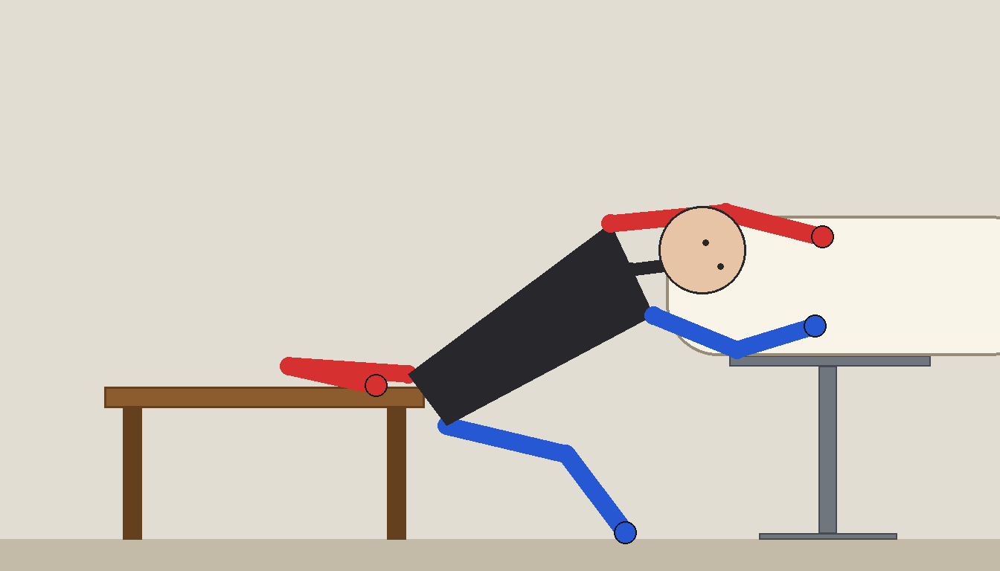 | 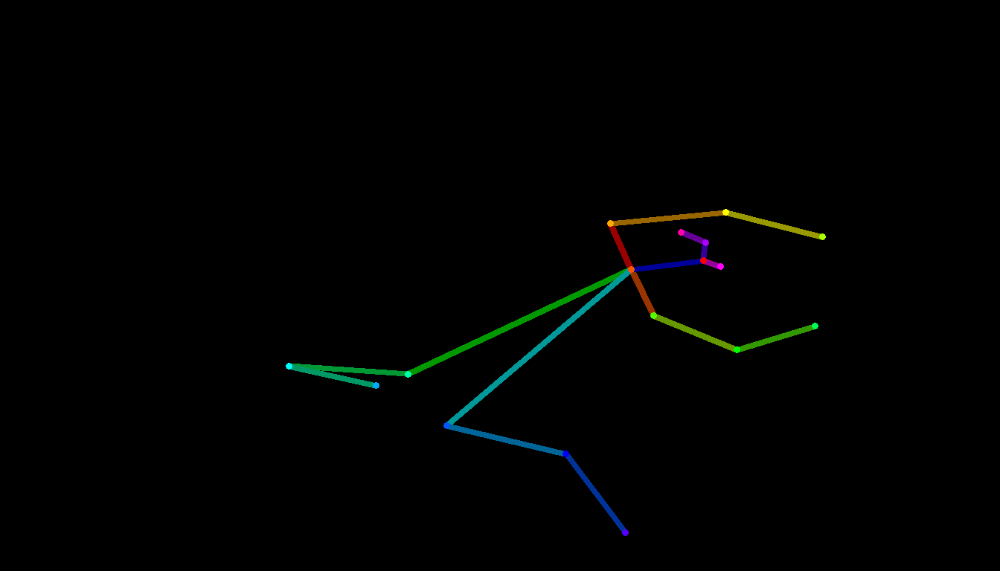 | 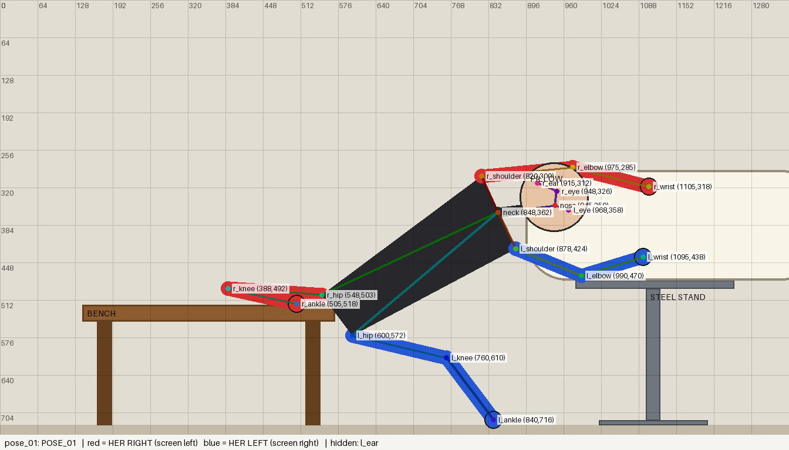 |

| 경로 | seed 101 | seed 202 | seed 303 | 평균 PCK |
|---|---|---|---|---|
| A-sketch (Klein 참조) | FAIL 0.36 | FAIL 0.21 | FAIL 0.29 | 0.29 |
| **A-openpose (Klein 참조)** | **PARTIAL 0.64** | FAIL 0.36 | PARTIAL 0.57 | **0.52** |
| B-draft (SDXL ControlNet) | PARTIAL 0.50 | FAIL 0.07 | FAIL 0.00 | 0.19 |
| B (B-draft → Klein 다듬기) | FAIL 0.43 | FAIL 0.00 | FAIL 0.29 | 0.24 |

**메인 포즈는 어느 경로에서도 SUCCESS가 나오지 않았습니다.** 가장 나은 것은 경로 A-openpose입니다.

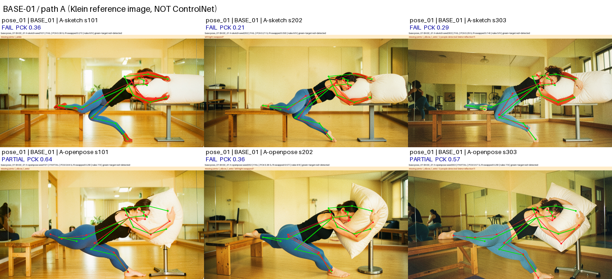
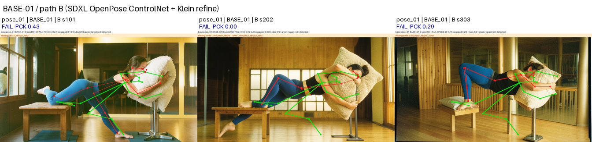

#### 대표 이미지 `output_01.png` 선정 — A-openpose seed 101 vs 303

| 확인 항목 | seed 101 (PCK 0.64, 규칙 7/9) | seed 303 (PCK 0.57, 규칙 7/9) |
|---|---|---|
| 오른쪽 엉덩이가 벤치 끝에 걸침 | ✗ 벤치에는 오른쪽 종아리·발만 놓이고 엉덩이는 벤치 밖 공중 | ✗ 같음 |
| 오른쪽 다리를 벤치 위에서 접음 | ✗ 곧게 뻗어 벤치 위에 올림 | ✗ 같음 |
| 왼발이 바닥을 지지 | ✓ | ✓ |
| 상체가 베개 쪽으로 기욺 | ✓ | ✓ |
| 두 팔이 베개를 감쌈 | △ 한 팔만 보이고 다른 팔은 베개 뒤로 가려짐(l_elbow·l_wrist 미검출) | ✓ 두 팔 모두 베개를 감쌈 |
| 얼굴이 베개에 닿음 | ✓ 얼굴 대부분이 묻힘 | ✓ 옆얼굴이 반쯤 보임(기획안에 더 가까움) |
| 좌우 뒤바뀜 | 의심 없음 (PCK 0.64 > 좌우반전 0.29) | 의심 없음 (0.57 > 0.29) |
| 거울·추가 인물 | 검출 1명. 왼쪽 거울에 자세가 다른 인물이 비침 | **검출 3명** — 거울에 실제와 맞지 않는 인물 2명 |

→ **`output_01.png` = A-openpose seed 101, 판정 PARTIAL** (그대로 기록). 자동 수치가 더 높고 장면에 혼란이 적어 선택했습니다. 팔·얼굴 관계는 seed 303([`base01_runs/pose_01__BASE_01__A-openpose__s303.png`](samples/base01_runs/pose_01__BASE_01__A-openpose__s303.png))이 더 기획에 가깝습니다.

| output_01.png | 검증 오버레이 (초록=목표, 빨강=검출) |
|---|---|
| 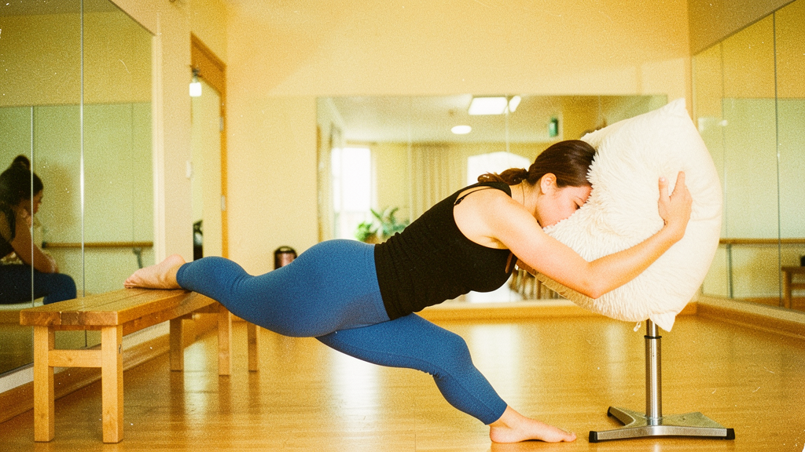 | 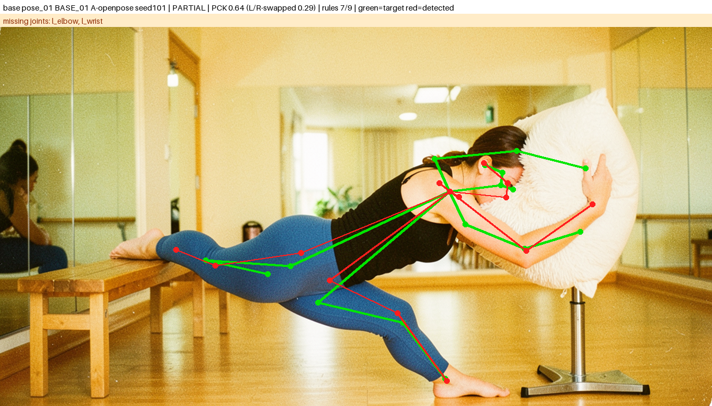 |

**재현된 것 / 안 된 것 (눈으로 본 판정)**: 벤치 → 몸 → 베개로 이어지는 대각선, 한 발 지지, 베개에 얼굴을 묻는 큰 구도는 전달됐습니다. 그러나 "한쪽 엉덩이만 벤치에 걸친 앉음"과 "가부좌로 접은 오른쪽 다리"는 경로 A·B의 12장 모두에서 재현되지 않았고, 모델은 이를 **벤치에 발을 올린 플랭크/런지 자세**로 바꿔 그렸습니다.

**경로 비교**
- A-openpose > A-sketch: 스케치 참조는 세 장 모두 **팔에 스케치의 빨간색이 옷/피부처럼 남았고**(자동 경고 임계값 미만이라 플래그는 안 뜸) 베개도 스케치의 긴 원통 모양을 따라 했습니다. 뼈대 참조는 이런 색 누출이 없었습니다.
- 경로 B(정식 ControlNet)는 오히려 낮았습니다. SDXL 초안(`pathB_runs/*B-draft*`) 세 장에는 **벤치·베개·받침대가 아예 그려지지 않았고**, 앞으로 뻗는 런지, 다리를 공중에 든 물구나무에 가까운 자세, 허리를 숙여 비튼 자세 등 서로 다른 자세가 나왔으며 한 장은 상의가 노란색이었습니다(평균 0.19). Klein 다듬기에서 소품은 다시 생겼지만 자세는 회복되지 않았습니다(평균 0.24). 원인은 확인하지 못했습니다. 수평에 가까운 특이한 뼈대가 SDXL OpenPose ControlNet에도 어려웠을 가능성, 77토큰으로 줄인 SDXL 프롬프트의 정보 부족, ControlNet 세기 0.75 설정 등을 의심합니다(추정).

### 2) 실험 2 — 같은 포즈(pose_01), 다른 프롬프트 (경로 A-openpose, seed 101/202)

| 프롬프트 ([prompts.md](prompts.md)) | 바꾼 것 | seed 101 | seed 202 | 평균 PCK |
|---|---|---|---|---|
| BASE_01 | (대조군) | PARTIAL 0.64 | FAIL 0.36 (좌우반전 의심) | 0.50 |
| P2_1_SUBJECT | 인물·복장 → 50대 남성, 회색 정장 | PARTIAL 0.50 (2명 검출) | FAIL 0.36 | 0.43 |
| P2_2_STYLE | 질감·조명 → 현대 디지털, 백색 주광 | PARTIAL 0.57 | FAIL 0.43 | 0.50 |
| P2_3_CONFLICT | 자세 문장 → "똑바로 서 있다" | FAIL 0.21 (5명 검출) | FAIL 0.29 (3명 검출) | **0.25** |

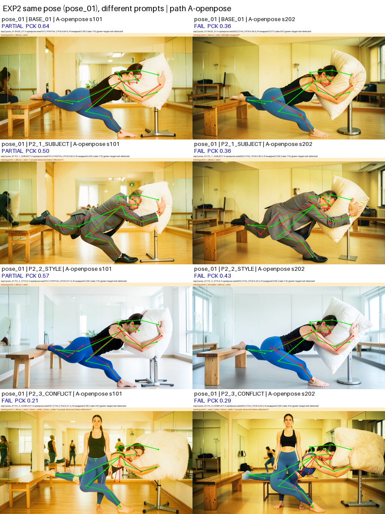

- **인물·복장 변경**: 정장 남성으로 바뀌었지만 같은 시드에서 몸의 배치(벤치에 발 → 대각선 → 베개)는 거의 그대로였습니다. 포즈 영향은 작았습니다.
- **스타일 변경**: 조명·색감은 확실히 바뀌었고 자세는 그대로였습니다(평균 PCK 동일).
- **충돌 문장**: 두 시드 모두 **사람이 두 명으로 갈라졌습니다** — 글을 따른 "똑바로 선 여성"과 뼈대를 따른 "베개에 기댄 사람"이 한 장면에 함께 나왔습니다. 모델이 두 조건을 한 사람으로 합치지 못하고 사람을 늘려 둘 다 만족시킨 것으로 보입니다. 평균 PCK가 0.50 → 0.25로 크게 떨어졌습니다(시드 2개라는 제한된 실험에서의 관찰).
- **시드 영향**: 같은 프롬프트에서도 seed 101과 202의 PCK 차이가 0.14~0.29였고, 이는 인물·스타일 변경으로 생긴 차이와 비슷한 크기입니다. 따라서 인물·스타일 변경의 영향은 이 실험 규모로는 "작다"까지만 말할 수 있고, 충돌 문장의 영향만 눈으로도 분명했습니다.

### 3) 실험 3 — 같은 프롬프트, 다른 포즈 (경로 A-openpose, seed 101/202)

| 포즈 | BASE_01 (자세 묘사 포함) | BASE_01_NEUTRAL (자세 문장 제거) |
|---|---|---|
| pose_01 복합 자세 | PARTIAL 0.64 / FAIL 0.36 → 평균 0.50 | PARTIAL 0.86 / PARTIAL 0.64 → 평균 0.75 |
| pose_02 선 채로 오른손 들기 | PARTIAL 0.79 / PARTIAL 0.50 → 평균 0.64 | **SUCCESS 1.00 / SUCCESS 1.00** → 평균 1.00 |
| pose_03 벤치에 바르게 앉기 | PARTIAL 0.64 / **SUCCESS 0.86** → 평균 0.75 | PARTIAL 0.71 / PARTIAL 0.57 → 평균 0.64 |

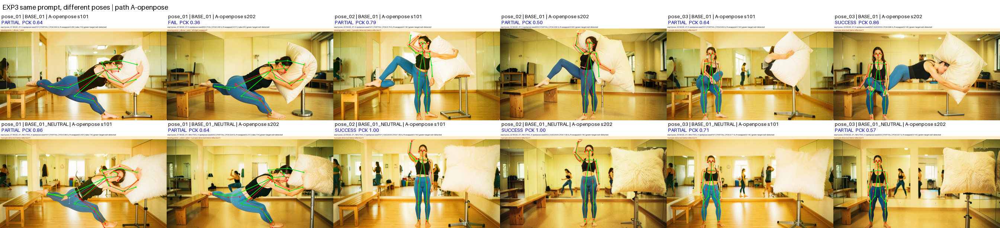

| pose_02 참조 → output_02.png (SUCCESS, PCK 1.00, 3명 검출) | pose_03 참조 → output_03.png (자동 PARTIAL 0.71, 눈으로는 실패) |
|---|---|
| 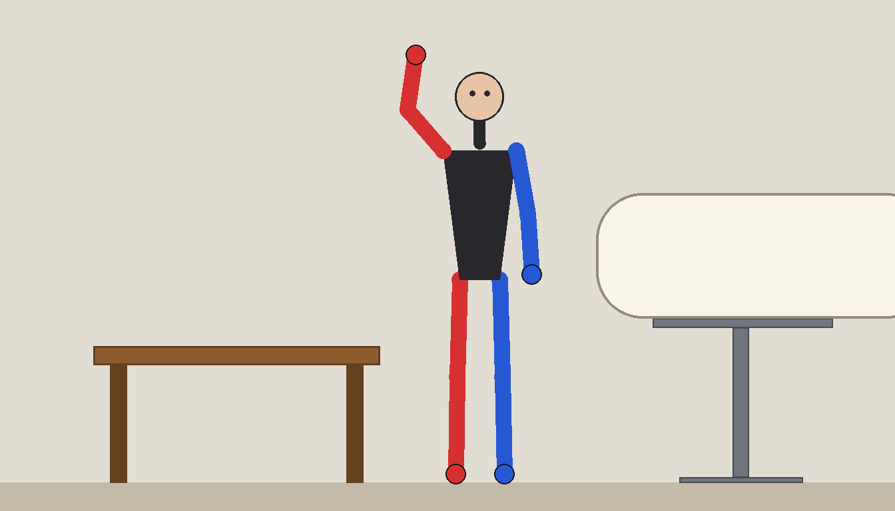 | 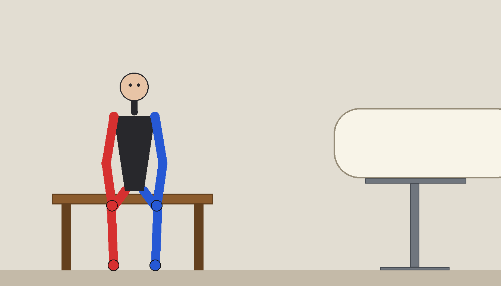 |
| 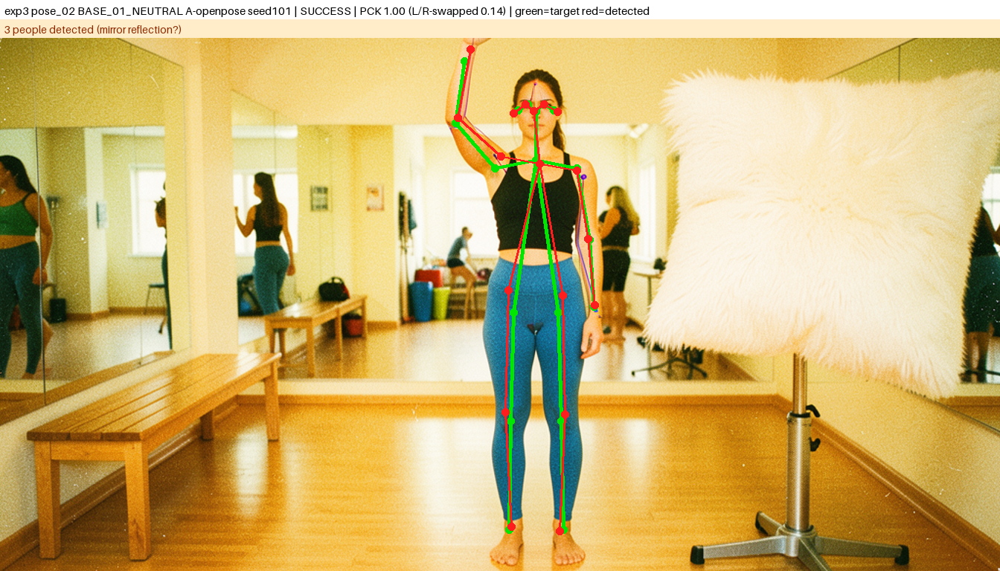 | 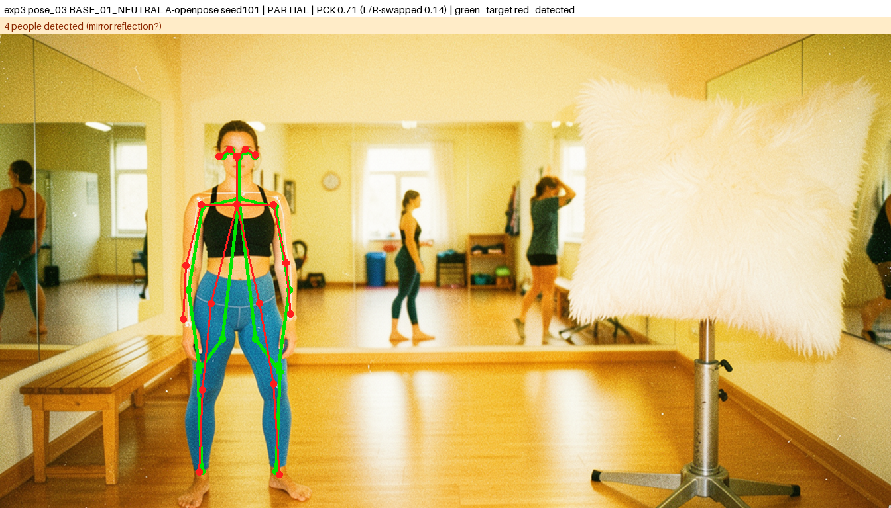 |

**자동 판정과 눈으로 본 판정이 크게 다른 사례**
- **pose_02 × NEUTRAL (SUCCESS 1.00)**: 실제로 정면에 서서 오른손을 든 자세가 맞습니다. 검출 3명은 거울 속에 실제와 맞지 않는 다른 인물들이 그려졌기 때문이며, 점수는 앞의 주인공에게서 나온 것을 오버레이로 확인했습니다. → 자세는 성공, 장면은 "거울 속 엉뚱한 인물" 문제 있음.
- **pose_03 × BASE_01 seed 202 (자동 SUCCESS 0.86)**: 눈으로 보면 **벤치에 앉은 여성의 하체에 베개로 엎드린 또 다른 상체가 이어 붙은 기형**입니다. 앉은 자세 뼈대와 글의 "베개에 기대는 자세"가 한 몸에 섞였습니다. → 자동 SUCCESS지만 실제로는 실패.
- **pose_03 × NEUTRAL (PARTIAL 0.71/0.57)**: 사람이 벤치 앞에 **서 있습니다**(앉지 않음). 정면에서 본 앉은 자세는 허벅지가 짧게 보일 뿐 2D 관절 위치가 선 자세와 거의 같아서, 뼈대로도 PCK로도 "앉음"을 구분하지 못했습니다. 포즈 설계(pose_03 뼈대)의 한계이기도 합니다.
- **pose_01 × NEUTRAL seed 101 (PCK 0.86)**: 관절 위치는 가장 가까웠지만, 베개를 **등으로** 받치고 얼굴을 카메라 쪽으로 든 자세라 "베개를 끌어안고 얼굴을 묻는" 기획과 앞뒤가 반대입니다. 2D 뼈대는 앞/뒤를 구분하지 못합니다.
- **pose_02 × BASE_01**: 손을 들긴 했지만 한 다리를 벤치에 올리고 다른 팔로 베개를 감싸는 등 글의 pose_01 묘사가 섞인 혼합 자세가 나왔습니다.

**정리**
- 단순한 선 자세(pose_02)는 자세 중립 프롬프트에서 두 시드 모두 정확히 재현됐고, 복잡한 pose_01은 한 번도 완전히 재현되지 않았습니다. 단순한 포즈가 더 안정적이라는 경향은 보였지만, 포즈마다 관절 검출 난도가 다르고 시드가 2개뿐이라 수치만으로 우열을 단정하지는 않습니다.
- 자세 문장을 뺀 NEUTRAL 프롬프트는 **참조 포즈가 글의 자세 묘사와 다를 때(pose_02)** 확실히 도움이 됐습니다. 글과 뼈대가 같은 자세를 말하는 pose_01에서는 수치는 올랐지만 앞뒤가 뒤집힌 결과가 나와, 글의 자세 묘사가 "어느 면이 베개를 향하는지" 같은 관계 정보를 보완하는 역할도 한다는 점을 보여 줬습니다.

## 한계
- **경로 A는 정식 ControlNet이 아닙니다.** Klein 4B의 참조 이미지 기능을 포즈 조건처럼 쓴 것이라 따르는 정도가 보장되지 않습니다.
- **자동 검증기의 한계**: (1) 2D 관절 위치만 비교해 앉음/섬, 앞/뒤를 구분하지 못함 (2) BASE-01 규칙은 소품이 스케치 위치에 그려졌다고 가정하지만 실제 생성된 벤치·베개 위치는 달랐음 — 그래서 규칙 7/9는 참고용이며, 규칙별 세부 결과는 기록되지 않아 어떤 두 항목이 실패했는지는 남아 있지 않음 (3) 거울 속 인물·합쳐진 신체를 구분하지 못함.
- 시드 2~3개의 소규모 실험이라 평균 PCK 차이는 경향으로만 읽어야 합니다.
- T4 메모리 제약으로 Klein 결과는 1024×576입니다(SDXL 초안은 1344×768).

## 사용 모델과 라이선스
| 모델 / 라이브러리 | 용도 | 라이선스 |
|---|---|---|
| [`black-forest-labs/FLUX.2-klein-4B`](https://huggingface.co/black-forest-labs/FLUX.2-klein-4B) | 경로 A 생성, 경로 B 다듬기 | Apache-2.0 |
| [`stabilityai/stable-diffusion-xl-base-1.0`](https://huggingface.co/stabilityai/stable-diffusion-xl-base-1.0) (fp16) | 경로 B 초안 | CreativeML Open RAIL++-M |
| [`xinsir/controlnet-openpose-sdxl-1.0`](https://huggingface.co/xinsir/controlnet-openpose-sdxl-1.0) | 경로 B 포즈 조건 | Apache-2.0 |
| [`lllyasviel/Annotators`](https://huggingface.co/lllyasviel/Annotators) body_pose_model | 결과 검증 (OpenPose 재추출) | CMU OpenPose — 비상업 용도 |
| diffusers 0.42.1, transformers, controlnet_aux 0.0.10 | 파이프라인·전처리 | Apache-2.0 |

## 폴더 구조
```
pose-image-tool/
├── README.md
├── pose_tool.ipynb            # Colab 튜토리얼 노트 (셀마다 "이 셀이 하는 일" 주석, 마지막 셀에 관찰 기록)
├── prompts.md                 # 모든 프롬프트 원문 + 실험·파일 대응표
└── samples/
    ├── pose_0X.png / _openpose.png / _layout.png / _keypoints.json   # 참조 포즈 (01: BASE-01, 02·03: 비교용)
    ├── output_01.png / output_02.png / output_03.png (+ _verify.png, .json)   # 대표 결과와 판정
    ├── base01_runs/  pathB_runs/  exp2_same_pose/  exp3_same_prompt/        # 모든 생성 결과 + 검증 오버레이
    ├── base01_pathA_grid.png  base01_pathB_grid.png  exp2_grid.png  exp3_grid.png
    ├── results.json  results_summary.md  prompts_used.json
```

## 고찰 및 회고

### 1. 실험 조건을 어렵게 설정한 이유
이번 과제에서는 모델이 쉽게 재현할 수 있는 일반적인 직립 자세 대신, 의도적으로 난도가 높은 복합 자세를 목표로 삼았습니다. 목표 자세는 한쪽 엉덩이만 벤치에 걸친 채 한쪽 다리는 접고, 다른 쪽 다리로 바닥을 지지하면서 상체를 크게 기울여 베개를 양팔로 끌어안는 형태입니다. 이 자세에는 앉기·서기·기대기가 동시에 들어 있어, 관절 위치뿐 아니라 신체와 주변 물체 사이의 접촉 관계까지 표현해야 합니다. 이런 조건을 통해 이미지 생성 모델이 일반적이지 않은 신체 배치와 복잡한 공간 관계를 얼마나 충실하게 재현하는지 확인하고자 했습니다.

### 2. 거울 환경을 추가한 이유와 영향
배경도 단색 배경이 아니라 거울로 둘러싸인 요가 연습장으로 정했습니다. 거울은 같은 사람의 반사상을 추가 인물처럼 보이게 하고, 좌우 구분과 관절 검출을 혼란스럽게 할 수 있습니다. 실제 결과에서도 여러 이미지에 추가 인물 검출 경고와 좌우 혼동 가능성이 기록되었고, 거울 속에 실제 인물과 자세가 맞지 않는 사람이 그려진 경우도 있었습니다. 따라서 복잡한 인체 포즈와 거울 환경이 함께 주어지면서 이미지 생성과 자동 검증의 난도가 모두 높아졌을 가능성이 있습니다. 다만 이번 실험에서는 거울 유무만 따로 통제해 비교하지 않았으므로, 거울이 성능 저하의 직접적인 원인이라고 단정하지는 않습니다.

### 3. 실제 결과에 대한 평가
예상대로 가장 복잡한 pose_01은 모델이 완전히 재현하지 못했습니다. 특히 엉덩이를 벤치에 걸친 상태와 접은 다리, 팔로 베개를 끌어안는 관계, 다리의 지지 방식에서 목표 자세와 차이가 나타났습니다. 경로 A-openpose가 상대적으로 가장 좋은 결과를 보였지만, 메인 포즈는 자동 평가에서 부분 성공(PARTIAL) 수준에 머물렀습니다. 반면 pose_02처럼 단순한 포즈에서는 더 높은 PCK와 SUCCESS 판정을 얻은 사례가 있었습니다. 단, pose_03에서는 자동 SUCCESS가 나왔지만 실제로는 신체가 합쳐진 기형이었고, 자세 중립 프롬프트에서도 앉지 않고 서 있는 등 수치와 실제 모습이 일치하지 않았습니다. 또한 포즈를 고정하고 프롬프트만 바꾼 실험에서, 목표 포즈와 충돌하는 문장을 넣자 사람이 두 명으로 갈라지며 포즈 재현성이 크게 낮아졌습니다. 이는 생성 결과가 참조 포즈뿐 아니라 텍스트 조건의 영향을 함께 받는다는 점을 보여 줍니다.

### 4. 실험을 통해 얻은 교훈
같은 포즈를 참조하더라도 생성 모델이 이를 항상 정확히 따르지는 않는다는 점을 확인했습니다. 특히 OpenPose 골격은 관절 위치를 나타내는 데는 유용하지만, 어느 신체 부위가 어떤 물체에 닿아 있는지, 체중이 어디에 실리는지, 팔이 물체를 어떻게 감싸는지, 몸의 앞면이 어느 쪽을 향하는지 같은 관계까지는 충분히 표현하지 못합니다. 따라서 복잡한 포즈를 재현하려면 골격 조건뿐 아니라 소품 배치, 접촉 관계, 텍스트 프롬프트를 함께 설계해야 한다고 판단했습니다. 또한 자동 PCK만으로 성공 여부를 판단하기보다 실제 이미지를 직접 보고, 부자연스러운 신체 표현이나 추가 인물이 생기지 않았는지까지 검토해야 합니다.

### 5. 향후 개선 방향
추가 실험이 가능하다면 다음을 검토할 수 있습니다. (아래는 제안이며, 이번에 실행하지 않았습니다.)
- 거울이 없는 배경과 거울이 있는 배경의 비교
- 골격 조건에 신체와 소품의 접촉 영역을 명시하는 방법
- 팔·손목·얼굴과 베개의 접촉 관계를 강화하는 방법
- 같은 프롬프트·포즈에서 시드를 늘려 반복성 확인
- Klein 참조 이미지 방식과 FLUX 계열 정식 OpenPose ControlNet 적용 결과의 비교
- 검증기에 규칙별 결과 저장, 앉음/섬·앞/뒤를 구분할 수 있는 3D 또는 깊이 기반 검증 추가
